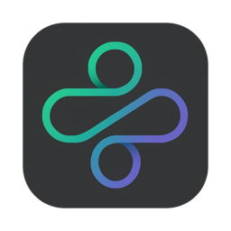

  

<h1 align="center">CareSync</h1>

  <b>Patient management for your practice.</b> 
  Private, works offline, and keeps every record encrypted on your own computer.

  
  
  

 

  
  &nbsp;&nbsp;
  

  
    Mac: Apple Silicon and Intel, macOS 10.15 or newer &nbsp;·&nbsp; Windows 10 or 11, 64-bit
     
    <a href="https://github.com/shernix/CareSync-releases/releases">All versions and what's new</a>
  

 

## Install in three steps

| | Mac | Windows |
| :---: | --- | --- |
| **1** | Click **Download for Mac** and open the `CareSync-macOS.dmg` file. | Click **Download for Windows** and run `CareSync-Windows-Setup.exe`. |
| **2** | Drag **CareSync** into the **Applications** folder. | Click through the installer. No administrator rights are needed. |
| **3** | Open CareSync from **Applications**, then approve it once (see below). | If Windows shows a warning, approve it once (see below). |

<b>Mac: "Apple could not verify CareSync…"</b>

 

CareSync isn't signed with a paid Apple developer certificate yet, so macOS asks you to approve it the first time:

1. Click **Done** on the warning.
2. Open **System Settings → Privacy & Security** and scroll down.
3. Click **Open Anyway** next to the CareSync message, then confirm with your Mac password.

You only do this once. Updates installed from inside CareSync don't ask again.

<b>Windows: "Windows protected your PC"</b>

 

SmartScreen shows this for apps without a paid code-signing certificate. Click **More info**, then **Run anyway**. You only do this once.

If your computer doesn't have Microsoft Edge WebView2 (it's built into Windows 11), the installer adds it, which needs an internet connection.

## Get started

1. **Create your account.** The first screen asks for a username, email and password. Each person in the practice creates their own account on the same computer.
2. **Add patients.** New patients are visible only to you. To share one, open the patient and choose **All users** or **Specific users** in its **Access** section.
3. **Keep your password safe.** CareSync works offline, so there is no email reset. A forgotten password can't be recovered.

## Updates

Open the user menu (the person icon, top right) and choose **Check for updates**. If a new version is available, click **Update now**. CareSync saves a copy of your data, installs the update and restarts.

CareSync only goes online when you check for updates. It never sends your data anywhere.

## Your data stays yours

- **On your computer only.** Patient records are stored locally, never in the cloud.
- **Encrypted.** The database is encrypted, with its key kept in your Mac's Keychain or Windows Credential Manager.
- **Private per user.** Each person logs in and sees only the patients they own or that were shared with them.
- **Backups when you want them.** **Data & Backups** saves your patients to Excel or JSON, and every export is recorded.

## Questions

<b>My Mac asks for my password after an update. Is that normal?</b>

 

Yes. macOS checks that the updated CareSync may still use its encryption key. Enter the password you use to log in to your **Mac** (not your CareSync password) and click **Always Allow**.

<b>Do I need the internet?</b>

 

Only to download CareSync and to check for updates. Everything else works offline.

<b>Where is my data stored?</b>

 

- **Mac:** `~/Library/Application Support/com.caresync/`
- **Windows:** `%APPDATA%\com.caresync\`

The `backups` folder there holds automatic encrypted copies, made before every import and update.

<b>How do I move to a new computer?</b>

 

On the old computer, use **Data & Backups → Save as Excel** or **Save as JSON**. Install CareSync on the new computer, create your account, then use **Data & Backups → Import from file**.

Accounts aren't part of backups, so each person creates their account again. On a Mac, moving everything with Migration Assistant also works.

<b>I forgot my password.</b>

 

It can't be reset, because CareSync has no online account system. Create a new account and ask the owners of shared patients to share them with you again. Patients that were set to "Only me" under the old account stay private to it.

